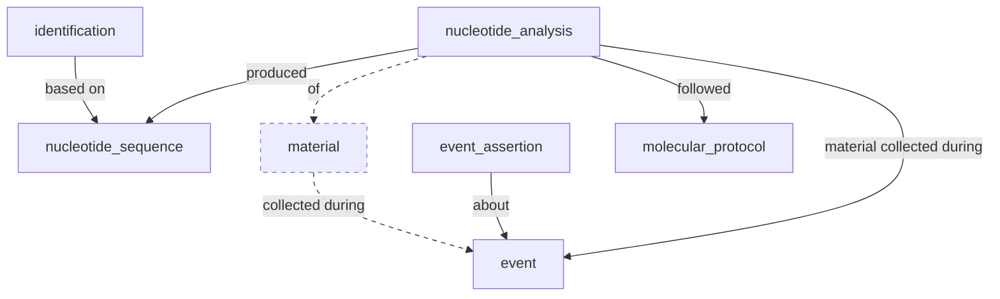

# OBIS eDNA Expeditions example dataset

This example maps a subset of the OBIS eDNA Expeditions project to DwC-DP, following the table structure used by the [GBIF Metabarcoding Data Toolkit (MDT)](https://github.com/gbif/metabarcoding-data-toolkit-backend) DwC-DP export but with addition of `material` as this is required by the SQL schema in this repo.

Input files are Occurrence core and DNADerivedData extension tables exported from the eDNA Expeditions data platform, for two field samples from Calanques: `OBIS_EDNA_140` and `OBIS_EDNA_142`. Control samples are omitted for now.

## Mapping notes

- No `occurrence` table, detections are `nucleotide_analysis` rows (sample x ASV, with `read_count`). Taxonomy is on `identification` linked by `nucleotide_sequence_id`.
- Each distinct `DNA_sequence` appears once in `nucleotide_sequence` (and once in `identification`).
- Material is one environmental sample per event (required by the `nucleotide_analysis.material_entity_id` foreign key).
- Molecular protocols: one row per distinct assay (12 markers/primer sets in this subset).

Output tables: `event`, `event_assertion`, `material`, `molecular_protocol`, `nucleotide_sequence`, `nucleotide_analysis`, `identification`.

Relationships from the [DwC-DP table schemas](https://github.com/tdwg/rs.tdwg.org/tree/master/dwc-dp/table-schemas):



Dashed edges and node are the material stub added for this repo's schema, MDT omits them.

In this example, `identification` is only based on `nucleotide_sequence` (not on material or analysis). `nucleotide_analysis` is one row per sample x ASV detection (`readCount`).

## Input data

`input_data/` is gitignored. To re-run the pipeline, place locally:

- `input_data/occurrence.tsv`
- `input_data/dnaderiveddata.tsv`

## Create a PostgreSQL database

```cd edna/obis-edna-expeditions```

First time:

```createdb obis_edna_expeditions && psql obis_edna_expeditions -f ../../gbif/dwc_dp_schema.sql && psql obis_edna_expeditions -f ./schema_input_obis_edna.sql```

Subsequent times:

```dropdb obis_edna_expeditions && createdb obis_edna_expeditions && psql obis_edna_expeditions -f ../../gbif/dwc_dp_schema.sql && psql obis_edna_expeditions -f ./schema_input_obis_edna.sql```

## Load the input data

```psql obis_edna_expeditions -f load_input_obis_edna.sql```

## Map to DwC-DP tables

```psql obis_edna_expeditions -f map_obis_edna_input.sql```

## Export TSV files

```psql obis_edna_expeditions -f export_obis_edna_tsvs.sql```

## Optional: DwC headers and datapackage.json

From `dwc_dp/tools` run:

```python lsc_to_dwc_headers.py -i path_to/dwc-dp-examples/edna/obis-edna-expeditions/output_data/ -o path_to/dwc-dp-examples/edna/obis-edna-expeditions/output_data/```

```python make_dp.py -p path_to/dwc-dp-examples/edna/obis-edna-expeditions/output_data/ -t "OBIS eDNA Expeditions DwC-DP example" -n "OBIS eDNA Expeditions"```
